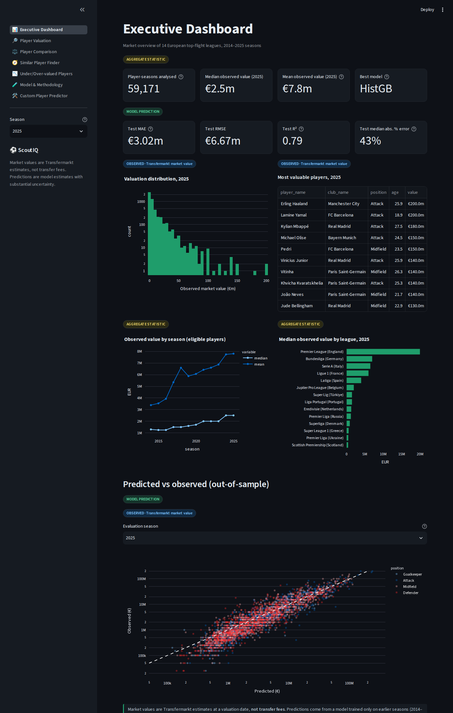
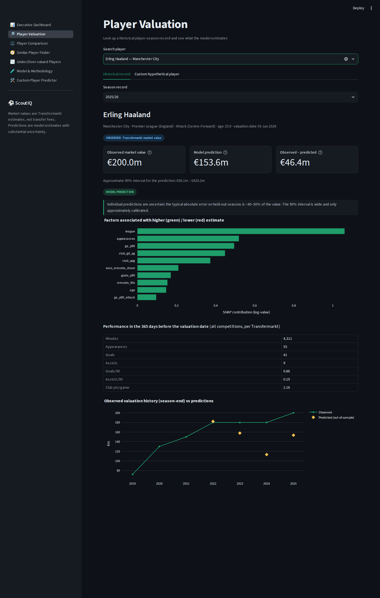
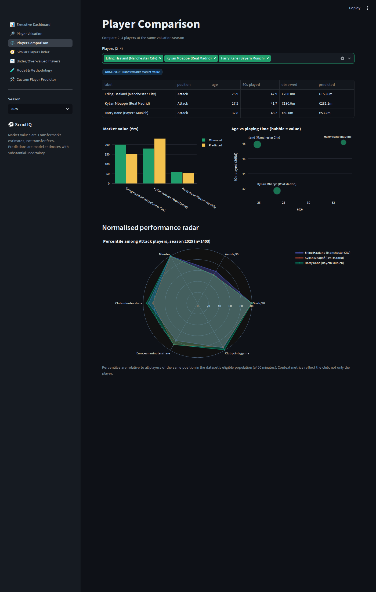
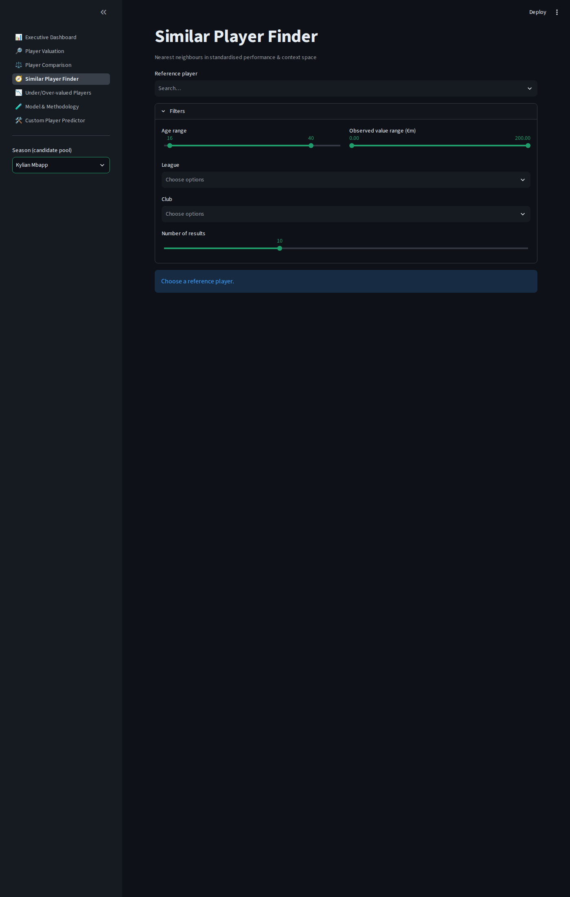
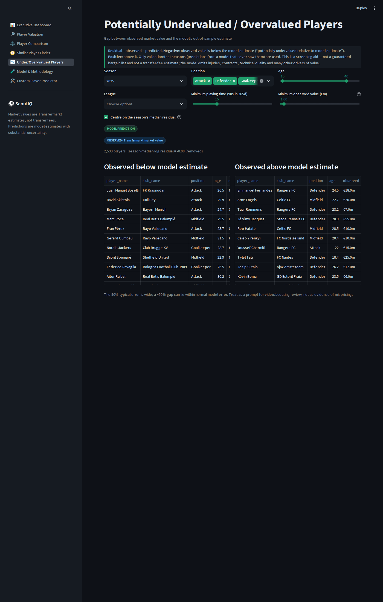
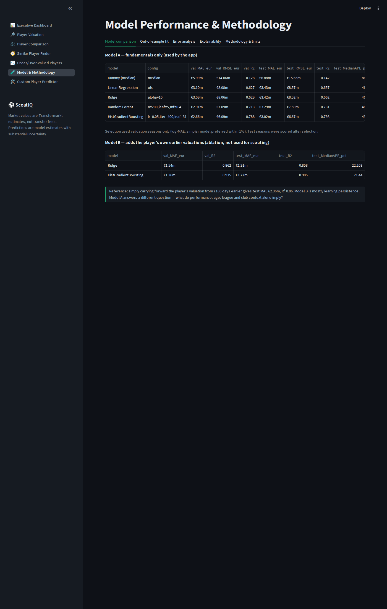
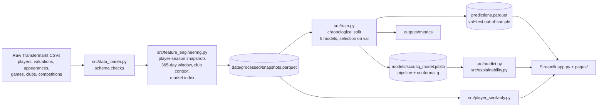

# ⚽ ScoutIQ — Football Transfer Value Predictor & Scouting Intelligence Platform

ScoutIQ estimates **Transfermarkt market values** of professional footballers from their previous-12-month
performance, age, position, league and club context, then uses the model for scouting-style questions:
who looks valued below/above the model estimate, who is statistically similar, and *why* the model says what it says.

> **Market value ≠ transfer fee.** The target is Transfermarkt's dated valuation of a player, not what a club paid.
> All outputs are model estimates with substantial uncertainty and are not financial or transfer advice.

| | |
|---|---|
| Live demo | _not deployed yet_ (see [Deployment](#deployment)) |
| Repository | _add your GitHub URL_ |

## Screenshots (captured from the running app)
| Dashboard | Player valuation + SHAP |
|---|---|
|  |  |
| Comparison (radar) | Similar players |
|  |  |
| Under/over-valued | Methodology & performance |
|  |  |

## Results (all numbers produced by `python -m src.train`; see `outputs/metrics/`)
Chronological split by season — train 2014–2021 (39,311 player-seasons), validation 2022–2023 (10,076),
**test 2024–2025 (9,784)**. Model chosen on validation only; test scored afterwards. Metrics are in EUR.

| Model (fundamentals only) | Val MAE | Test MAE | Test RMSE | Test R² | Test median abs. % error |
|---|---|---|---|---|---|
| Dummy (median of log-value) | €5.99m | €6.88m | €15.65m | −0.14 | 86% |
| Linear regression | €3.10m | €3.43m | €8.57m | 0.66 | 47% |
| Ridge (α=10) | €3.09m | €3.42m | €8.52m | 0.66 | 47% |
| Random forest | €2.91m | €3.29m | €7.59m | 0.73 | 46% |
| **HistGradientBoosting (selected)** | **€2.66m** | **€3.02m** | **€6.67m** | **0.79** | **43%** |

How to read this honestly:
* A typical player's estimate is off by roughly **40–45 %** (median absolute % error); the error is dominated by what
  the features cannot see (injury, contract, hype, technical quality — no xG/passing data is in this dataset).
* R² is computed in EUR and is driven by the few very expensive players. On the log scale, test R² is 0.82.
* **Ablation (Model B)** adds the player's own valuation from ≥180 days earlier: test MAE €1.77m, R² 0.91. Simply
  carrying that old valuation forward already gives MAE €2.36m / R² 0.86 — i.e. Model B mostly learns persistence,
  which is why scouting features (residuals, custom predictor) use Model A, and why Model A **does not beat naïve
  persistence** on raw accuracy (it answers a different question).
* Systematic shrinkage: players under €0.5m are over-predicted and those ≥€10m under-predicted (see `outputs/metrics/error_by_value_band.csv`).
* **Uncertainty**: split-conformal intervals (calibrated on validation) covered **76.8 %** (nominal 80 %) and
  **88.4 %** (nominal 90 %) of test values — slightly under-covering because of valuation drift — and are wide
  (median upper/lower ratio ≈ 7.5× at 90 %).
* Player overlap check: players already seen in training have log-MAE 0.51 vs 0.53 for unseen players, so repeated
  players are not what drives the scores.
* Valuation inflation: a plain log target had test bias of −0.28 (log) and test MAE €3.69m / R² 0.64; deflating the
  target with a prior-season market index gave +0.15 bias, MAE €3.02m, R² 0.79 (`notebooks/model_experiments.ipynb`).
  Bias is reduced, not eliminated.

## What it does (7 pages)
1. **Executive Dashboard** – player-seasons, value distribution, top players, trends, honest out-of-sample scatter.
2. **Player Valuation** – search a player; observed vs predicted (only for out-of-sample seasons), 90 % interval, SHAP factors, stats; hypothetical-player tab.
3. **Player Comparison** – 2–4 players: values, age/minutes, percentile radar (disabled for mixed positions; missing metrics omitted).
4. **Similar Player Finder** – standardised nearest neighbours within a position group with age/league/club/value filters; similarity ≠ probability.
5. **Under/Over-valued** – residual = observed − predicted on validation/test seasons only, filters incl. minimum minutes and value.
6. **Model & Methodology** – comparison table, fit plots, error analysis, importance/SHAP, provenance, limitations.
7. **Custom Player Predictor** – validated form, conformal intervals, SHAP explanation, comparable players.

## Architecture

**Workflow:** raw CSV → validated tables → one row per player-season (last valuation of each season; features from
the 365 days *before* that date) → leakage-safe chronological split → pipeline (imputation, one-hot, optional scaling,
model, log-and-deflate target) → saved bundle → the app loads the same pipeline for every prediction.

## Target and features
* **Target:** Transfermarkt `market_value_in_eur` on the last valuation date of each season (season *s* = Jul *s*–Jun *s+1*); modelled as log-value minus a market index.
* **Market index:** median log-value of the eligible population in the *previous* season (known before any valuation in the current one). Removes valuation inflation without using future information.
* **Features:** age (+age²), height, foot, position, sub-position, league; minutes, appearances, 60+-minute matches, goals/assists/cards per 90, position-specific G+A per 90 (so goalkeepers are not scored like forwards); share of minutes in European club cups; club points/game and goal difference/game; share of club minutes played.
* **Excluded as leakage:** current/peak market value, caps, contract expiry, club totals and any other scrape-time snapshot columns.
* **Eligibility:** ≥450 minutes in the preceding 365 days, age 15–45, club in one of 14 leagues with appearance data (BE1, DK1, ES1, FR1, GB1, GR1, IT1, L1, NL1, PO1, RU1, SC1, TR1, UKR1). 656k raw valuations → 59,171 modelled player-seasons (16,913 players); funnel in `outputs/metrics/data_quality.json`.

## Setup
```bash
python -m venv .venv && source .venv/bin/activate
pip install -r requirements.txt            # add requirements-dev.txt for tests/notebooks
# 1. put the Transfermarkt CSVs in data/raw/   (see data/README.md)
python -m src.feature_engineering          # build data/processed/snapshots.parquet
python -m src.train                        # trains, selects, saves models/ + outputs/metrics + predictions
python scripts/make_figures.py             # static figures in outputs/figures (after SHAP; see below)
streamlit run app.py
python -m pytest                           # 28 tests
```
The repository already contains the processed data (~6 MB) and the trained model, so you can run
`streamlit run app.py` without the raw files. SHAP/permutation artefacts (`outputs/metrics/permutation_importance.csv`,
`shap_global.npz`, `models/shap_background.parquet`) are produced by `src/explainability.py` (see
`scripts/run_explainability.py`). Notebooks: `python scripts/build_notebooks.py` regenerates and executes them.

## Repository layout
```
app.py                      Streamlit entry (st.navigation)
pages/                      7 page scripts
src/  config, data_loader, feature_engineering, preprocessing, train, evaluate,
      predict, explainability, player_similarity, formatting, ui
notebooks/                  exploratory_data_analysis.ipynb, model_experiments.ipynb (executed)
scripts/                    make_figures, run_explainability, build_notebooks, take_screenshots
tests/                      28 tests (metrics, windows/leakage, loader, similarity, inference consistency)
models/  data/  outputs/    artefacts (raw data git-ignored)
```

## Testing & validation done
* Window features were checked against brute-force recomputation for random snapshots; unit tests assert that appearances on/after the valuation date and older than 365 days are excluded.
* `tests/test_model_pipeline.py` rebuilds features from raw inputs and checks the prediction equals the stored one (train/inference consistency), validates rejection of impossible inputs, and checks the split is chronological with no duplicate player-seasons.
* Every page was exercised headlessly (Streamlit `AppTest`) including selections, mixed-position comparison and invalid form input.

## Limitations & ethics
* No xG/xA, shots, passing, progression or goalkeeper stats in this dataset; "starts" are unavailable (60+-minute matches used as a proxy).
* Valuations are subjective, rounded and irregularly updated; the model learns Transfermarkt's behaviour, not intrinsic worth.
* League is the most important feature by permutation importance — mostly a proxy for club wealth and visibility. Importance/SHAP show model associations, **not causal effects**.
* Over-prediction of cheap players, under-prediction of stars; loanees inherit their host club's context; only regular players (≥450 min) are modelled.
* Residuals are a *screening aid*, not evidence of a bargain; they ignore contracts, injuries, wages and fit. Don't use for decisions about real people or money.
* Data licensing: verify Kaggle/Transfermarkt terms before redistributing (`data/README.md`).

## Deployment
Streamlit Community Cloud: push the repo (including `data/processed/` and `models/`), choose `app.py`, Python 3.12.
The pickled model needs the pinned scikit-learn version. No secrets are required. _Live URL not created by this project run._

## Resume-ready description
**ScoutIQ – Football Transfer Value Predictor (Python, scikit-learn, SHAP, Streamlit, Plotly)** · Built an end-to-end
ML application on 656k Transfermarkt valuations: leakage-safe player-season feature pipeline (365-day windows, club context,
prior-season market index), chronological train/validation/test evaluation of five regressors against a dummy baseline;
selected HistGradientBoosting reached **R² 0.79 and €3.0m MAE on held-out 2024–25 seasons** (dummy: €6.9m MAE).
Added split-conformal intervals (empirical 88% coverage at nominal 90%), SHAP/permutation explanations, kNN player similarity,
out-of-sample valuation-residual screening, 28 automated tests and a 7-page Streamlit dashboard.
